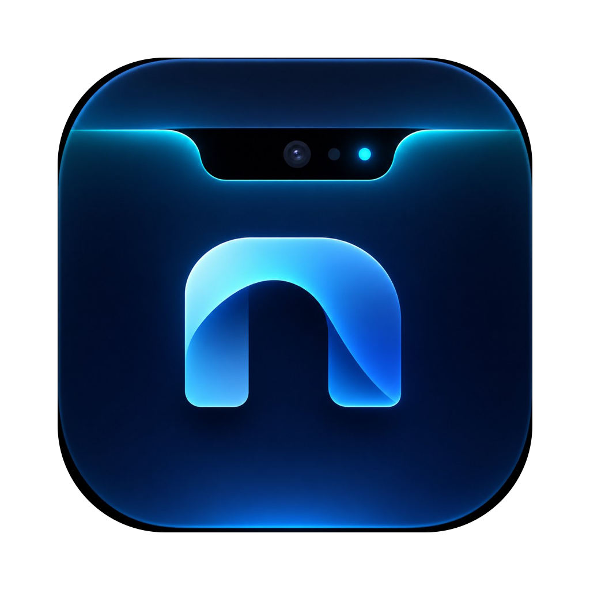

<p align="center">
  
</p>

<h1 align="center">nnotch</h1>

<p align="center">
  <strong>Centro de control interactivo y modular en el notch para macOS</strong><br />
  Construido 100% en <strong>Swift + SwiftUI</strong>, sin dependencias externas y compilable desde terminal sin Xcode completo.
</p>

> Basado originalmente en [`sayweer/dynamicIsland`](https://github.com/sayweer/dynamicIsland) (MIT), adaptado, rediseñado y evolucionado como proyecto propio **nnotch**.

---

## Funcionalidades principales

### 1. Notch nativo e indicadores configurables
- **Ventana flotante nativa (`NotchPanel` + `NotchHostingView`):** panel `NSPanel` transparente sobre la barra de menú que no roba foco y deja pasar los clics fuera de la isla.
- **Indicadores a ambos lados del notch cerrado (`CollapsedView`):** elegí qué ver a la izquierda y a la derecha (Automático, Hora, Fecha, Día de la semana, Batería, Música con ecualizador, Red, CPU, RAM, Temporizador o Vacío).
- **Compatible con pantallas sin notch:** opción para simular la píldora en monitores externos o Macs sin notch físico.

### 2. Inicio (`HomeView`)
- **Reproductor multimedia universal (`MusicManager`):** detecta Spotify, Apple Music, YouTube, YouTube Music, SoundCloud, Twitch, Netflix y cualquier navegador o app emitiendo audio (Brave, Chrome, Safari, Arc, Edge, Vivaldi, Zen, Firefox y apps nativas vía **CoreAudio**). Incluye carátulas/miniaturas HD, barra de progreso interactiva y controles de reproducción.
- **Zonas rápidas de AirDrop y Bandeja:** arrastrá archivos directo al notch para enviarlos por AirDrop o estacionarlos en la bandeja.
- **Accesos directos editables (`AppShortcutsStore`):** agregá tus apps favoritas con el botón `+` o arrastrándolas sobre la fila.
- **Métricas en tiempo real:** velocidad de red (subida/bajada), CPU y RAM.

### 3. Bandeja de archivos y Bandeja Flotante estilo Dropover (`ShelfView` + `FloatingShelfController`)
- **Bandeja del notch:** estacioná archivos, imágenes o texto; soporta selección individual, `⌘`-clic, selección por rectángulo, arrastre múltiple, AirDrop y vaciado con confirmación.
- **Bandeja flotante propia (sin requerir Dropover):** mientras arrastrás archivos desde Finder, **sacudí el mouse de izquierda a derecha** rápidamente para invocar la bandeja junto al cursor (o abrila desde el menú de nnotch → **Abrir bandeja flotante**).
  - **Arrastrable desde la parte superior:** dejá apretado el clic en la franja superior invisible para mover la bandeja libremente por la pantalla sin barra de título.
  - **Pila compacta con contador:** los archivos se apilan uno arriba de otro mostrando solo la cantidad total.
  - **Arrastre en bloque y cierre automático:** arrastrá la pila hacia otra app o carpeta en Finder para moverlos todos juntos; la bandeja se vacía y cierra automáticamente (con limpieza diferida para evitar errores de copia en Finder). También podés vaciarla y cerrarla con el botón **Vaciar**.

### 4. Herramientas con alarma continua (`ToolsView` + `TimerCenter`)
- Grilla 2×2 equilibrada con **Pomodoro**, **Cuenta Regresiva**, **Cronómetro** y **Monitor de Sistema y Red** (con gráfico *sparkline* de red y estado de batería).
- **Alarma estilo despertador de iPhone:** cuando termina un Pomodoro o una Cuenta Regresiva, nnotch abre la pestaña de Herramientas y reproduce una alarma rítmica continua de 4 pulsos en bucle durante 15 segundos (en lugar de una notificación corta), con botón **Detener** visible en la tarjeta y notificación del sistema.
- Basado en reloj de pared: los contadores siguen siendo precisos incluso si la Mac entra en reposo.

### 5. Calendario y avisos de reuniones (`CalendarTabView` + `CalendarManager`)
- **Grilla mensual** de lunes a domingo con navegación entre meses, selección de día y links directos **Unirse** para Google Meet, Zoom y Microsoft Teams.
- **Multi-origen:** integrado con `EventKit` de macOS (incluidas cuentas de Google configuradas en Cuentas de Internet) y soporte para feeds `.ics` externos.
- **Avisos automáticos al comenzar un evento:** el notch se expande por 20 segundos mostrando título, horario y botón **Unirse**. Respeta los calendarios habilitados en **Cuentas**, agrupa eventos simultáneos, ignora eventos de todo el día y no repite avisos tras reiniciar.

### 6. Portapapeles (`ClipboardView` + `ClipboardManager`)
- Historial persistente de texto, enlaces, archivos e imágenes (límite configurable de 10, 20 o 50 elementos).
- Deduplicación por hash SHA-256, preservación de resolución original en imágenes y exclusión automática de datos sensibles (gestores de contraseñas como 1Password o tipos `Transient`/`Concealed`).

### 7. Notas rápidas y enlaces (`NotesTabView` + `NotesStore`)
- Bloc rápido persistente dentro del notch para anotaciones y links de acceso frecuente.

### 8. Ajustes y personalización (`SettingsView` + `Preferences`)
- Panel rápido dentro del notch y ventana completa de configuración: tamaño de isla (Compacto, Normal, Grande o personalizado), radio de esquinas, velocidad de animaciones, color de acento, respuesta háptica, módulos visibles e inicio al encender la Mac.

### 9. Eficiencia y bajo consumo en reposo
- Sin polling innecesario cuando la isla está cerrada: `TimerCenter` se detiene por completo sin contadores activos, `CalendarManager` programa un único wakeup al próximo evento/refresh, `SystemStats` y `NetworkMonitor` reducen o pausan su muestreo cuando no son visibles, y las miniaturas se reducen con `ImageIO` fuera del hilo principal.

---

## Descargar e instalar

[Descargar nnotch 0.6.1 para Apple Silicon](https://github.com/joacodelfino/nnotch/releases/download/v0.6.1/nnotch-0.6.1-arm64.dmg)

Requiere una Mac con Apple Silicon (M1 o posterior) y macOS 14 o posterior.

1. Descargá y abrí el archivo DMG.
2. Arrastrá **nnotch** a **Aplicaciones**.
3. Abrí nnotch desde Aplicaciones y expulsá el DMG.

Esta versión tiene firma local y todavía no está notarizada por Apple. macOS puede bloquear el primer inicio. Si descargaste la app desde esta release, podés autorizarla en **Configuración del Sistema → Privacidad y seguridad → Abrir igualmente** después de intentar abrirla.

Podés verificar la descarga con el archivo SHA-256 adjunto a la release. Las actualizaciones se instalan descargando la nueva versión y reemplazando la app en Aplicaciones después de cerrarla.

## Compilar desde el código

Para compilar se necesitan las Command Line Tools de Xcode (`xcode-select --install`).
Para generar el instalador ejecutá `bash scripts/build-dmg.sh`.

## Instalación y compilación

```bash
# 1. Clonar el repositorio
git clone https://github.com/joacodelfino/nnotch.git
cd nnotch

# 2. Compilar nnotch.app en modo release y ejecutarlo
./build-app.sh --run
```

El bundle compilado y firmado localmente (ad-hoc) queda en `build/nnotch.app`. Si querés instalarlo de forma permanente:

```bash
cp -R build/nnotch.app /Applications/
open /Applications/nnotch.app
```

---

## Permisos recomendados en macOS

- **Calendarios:** se solicita la primera vez en *Calendario → Permitir Calendario a nnotch*. Para ver Google Calendar, asegurate de tener tu cuenta de Google agregada en **Configuración del Sistema → Cuentas de Internet** con **Calendarios** activado.
- **Automatización (Apple Events):** necesario para leer y controlar Spotify, Apple Music y navegadores (Brave, Chrome, Safari, etc.). En Safari, además, activá *Desarrollo → Permitir JavaScript desde eventos de Apple* para controles completos en YouTube.
- **Notificaciones:** se solicitan al iniciar un Pomodoro o Cuenta Regresiva para avisarte si estás lejos de la Mac.

---

## Pruebas

El proyecto incluye pruebas automatizadas ejecutables por terminal sin Xcode:

```bash
# Pruebas de grilla mensual, cambios de horario (DST) y programación de avisos
bash scripts/test-calendar.sh

# Pruebas de ciclo de vida de timers/alarma, portapapeles, miniaturas e intervalos
bash scripts/test-performance.sh
```

---

## Estructura del proyecto

```text
Sources/NNotch/
├── App.swift                      # Punto de entrada (.accessory app)
├── AppDelegate.swift              # Ciclo de vida, barra de menú e inyección de estado
├── NotchWindow.swift              # NSPanel transparente, hit-testing y hover con histéresis
├── NotchViewModel.swift           # Estado de expansión, pestañas y alertas
├── FloatingShelfController.swift  # Bandeja flotante estilo Dropover y detector de sacudidas
├── Managers/                      # Lógica y estado (@MainActor ObservableObject)
├── Support/                       # Preferencias, persistencia atómica, geometría y utilidades
└── Views/                         # Vistas SwiftUI por módulo
AppBundle/                         # Info.plist y AppIcon.icns
scripts/                           # Tests unitarios y utilidades
build-app.sh                       # Compilación release (-O -whole-module-optimization) y firma
```

### Cómo agregar un nuevo módulo

1. **Estado / Lógica:** crear un manager `@MainActor final class MiModulo: ObservableObject` en `Sources/NNotch/Managers/`.
2. **Pestaña:** sumar el `case` en `IslandTab` (`Sources/NNotch/NotchViewModel.swift`).
3. **Vista:** crear la vista en `Sources/NNotch/Views/` y conectarla en el `switch vm.activeTab` de `Sources/NNotch/Views/ExpandedView.swift`.
